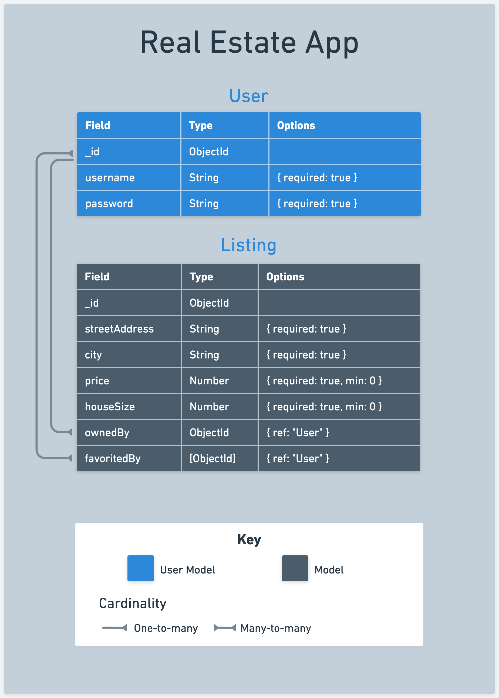

# 

**Learning objective:** By the end of this lesson, students will be able to tktk

## Real estate app

During this module, we are going to create a real estate application. This application will allow users to create listings for their own real estate. Details they will be able to track are:

- Street address
- City
- Price
- Size in sq ft
- Owner
- Users who have favorited the listing

Users can browse all listings, access listing details, create new listings, edit existing ones, and delete listings. Additionally, users can favorite or unfavor a listing.

The application includes user authentication and authorization. Users must sign up and log in to create, edit, or delete a listing. Moreover, users can only edit or delete a listing if they are its owner.

> The solution code for this module is located [here](https://git.generalassemb.ly/modular-curriculum-all-courses/men-stack-referencing-related-data-real-estate-solution)

## Project planning

Project planning plays a crucial role in projects, regardless of their size. It is an integral part of the real-world development process and establishes a valuable routine. Adopting this practice is beneficial for gaining insights into a project's scope and breaking it down into more manageable components.

The process of planning a project can take various forms. Yet, some fundamental elements add value to any project plan. These include:

- User stories
- ERDs

While these elements can be developed in any sequence, starting with user stories and then progressing to ERDs is often advantageous. User stories provide a comprehensive understanding of the application's functionality and user experience. At the same time, ERDs offer insights into the structure of the data.

### User stories

User stories are a way to describe an application's functionality from a user's perspective. They are often written in the format of:

> As a user, I want to do X.

This is an excellent way to describe and break down the functionality of an application. It is also an excellent way to get a sense of what the user experience will be like. User story creation is often an iterative process, and it is expected to start with a few user stories and then add more as the project progresses. This being an iterative process, there is often a way to track what is considered the minimum viable product (MVP) for an application. This is the minimum amount of functionality an application needs to be regarded as a viable product.

Let's create some user stories for our real estate application.

As a user:

- I want to create a new account.
- I want to log in to my account.
- I want to log out of my account.
- I want to create a listing for real estate that I own.
- I want to view all the listings created by every user on a single page.
- I want to view all the details of a listing, including its owner, on a new page by following a link from that index page.
- I want to delete a listing that I own.
- I want to edit any of the details of a listing that I own.
- I want to favorite a listing.
- I want to unfavorite a listing.
- I want to see how many people have favorited a listing.
- I want to view all the listings that I have favorited on a single page.

> 💡 Sometimes, you might see user stories written as `As a user, I want to do X because of Y`. This is an excellent way to add context to a user story, but it is optional.

From creating these user stories, we get a sense of what the functionality of our application will be, and we also now have a checklist of sorts to work through. 

### ERDs

Entity relationship diagrams (ERDs) are a way to describe the data that will be used in an application. Using the user stories we created above, we know we must keep track of users and listings. Before considering the relationships between users and listings, let's consider what data we need to keep track of for each resource.

For users, we need to keep track of:

- Username - String and is required
- Password - String and is required

For listings, we need to keep track of the following:

- Street address - String and is required
- City - String and is required
- Price - Number, minimum of 0, and is required
- Size - Number, a minimum of 0, and is required

tktk - Hunter can you make a ERD for this above data? No relationships yet, just the data.

> 💡 We are intentionally leaving off the favorites feature for now. We will add a field/value pair for this feature when we add relationships to our ERD.

Now, let's add in the relationships. First, let's dive into the relationship between users and listings. We want a user to be able to create, edit, and delete multiple listings they own. This is a one-to-many relationship. A user can have many listings, but a listing can only have one user.

We also have the favorites functionality that we will be adding later. A user can favorite many listings, and a listing can be favored by many users. This is a many-to-many relationship. To represent this in our ERD, we must have a new field name to house the relationship. We will call this field `favoritedBy`.

tktk - Hunter (David) here's a demo ERD, this should be replaced when assets are created, but it's a start:

