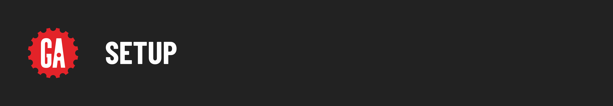

# 

Open your Terminal application and navigate to your `~/code/ga/lectures` directory:

```bash
cd `~/code/ga/lectures`
```

Make a new directory called `tktk-app-name`, then enter this directory:

```bash
mkdir tktk-app-name
cd tktk-app-name
```

Clone the auth repo:

```bash
git clone https://git.generalassemb.ly/modular-curriculum-all-courses/men-stack-session-auth-template.git
```

Create a `.env` file in your project's root directory:

```bash
touch .env
```

Assign your MongoDB Atlas connection string to the `MONGODB_URI` environment variable and add a `SESSION_SECRET`:

```plaintext
MONGODB_URI=mongodb+srv://<username>:<password>@sei-w0kys.azure.mongodb.net/?retryWrites=true
SESSION_SECRET=<yoursecret>
```

> 🚨 Do not use the above connection string in your application, it will not work.

Install dependencies with:

```bash
npm i 
```

Create a `.gitignore` file in your project's root directory:

```bash
touch .gitignore
```

Add the following to your `.gitignore` file:

```plaintext
.env
```

Open the project's folder in VS Code:

```bash
code .
```